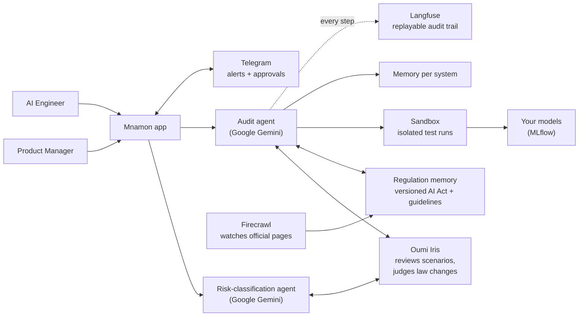
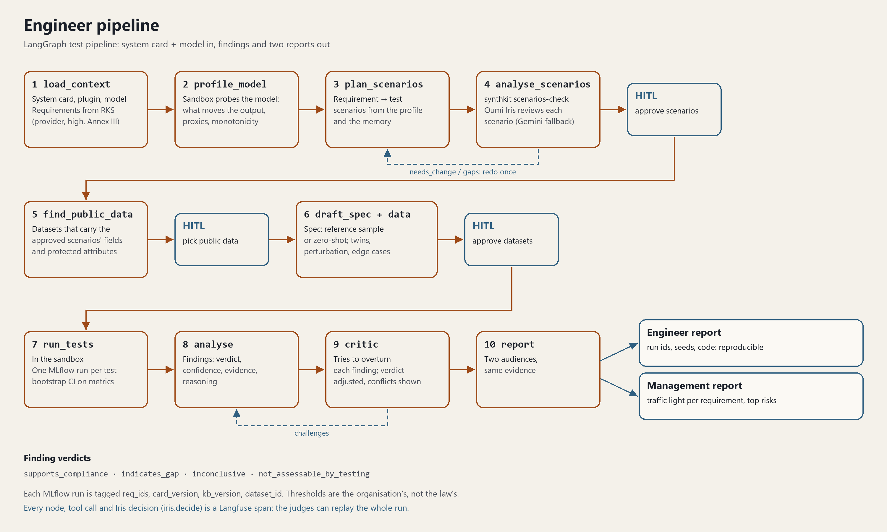

# Mnamon: EU AI Act audits that run themselves

**Mnamon is an in-house AI agent that audits your high-risk AI systems against the EU AI Act.** It reads the law, plans the tests, generates the test data, tests your real model, challenges its own findings and writes the reports. When the law changes, it finds what is affected and re-runs only what is needed. People approve every important step, and every step is recorded so an auditor can replay it.

> Built in 29 hours at the [Gen AI Summit Hackathon](https://hackathon.polymath42.com) (14–15 Nov 2026), on top of our own boilerplate (mAgenticX).

## Why it matters

Companies that build **high-risk AI** (hiring, credit scoring, access to public benefits, education and more) must prove that their systems are tested, fair, documented and kept up to date with the law. The fines go up to **€15M or 3% of global turnover**.

Today that proof is slow, manual work done with consultants and spreadsheets, and it goes out of date as soon as a guideline changes. Mnamon makes it **automatic, repeatable and provable**:

- **It does the work, not just advice.** It tests the real model, not a description of it.
- **Every claim has a source.** Each finding cites the article it rests on and is pinned to the exact law version and model version it was judged against.
- **It argues with itself.** A critic agent tries to disprove every finding before a human sees it.
- **Humans decide.** The agent proposes and people approve, in the app or on Telegram. Every decision is stored with its reason.
- **It learns.** If you reject a test, it remembers why and plans the next audit of that system around it.
- **It keeps up with the law.** A change in the law triggers impact analysis and a targeted re-run. Old results are marked out of date, never silently rewritten.
- **It runs in-house.** One command starts it on your own machines, so models and data never leave the company.

## Who it is for

| User | What Mnamon does for them | In this build |
| --- | --- | --- |
| **AI Engineer** | Connects the system's models, runs audits, approves the agent's plans and gets a technical report with reproducible evidence | **Built, end to end** |
| **AI Officer / compliance** | Sees every system, audit, finding and regulation change in one place, plus a management report per audit | Shared read view built; dedicated workspace planned |
| **Product Manager** | Registers a new AI system with its documents in a short wizard. A risk-classification agent proposes the AI Act risk class with citations and counter-arguments, Oumi Iris checks every claim, and a human approves | **Built** |

## Use cases

- **New AI system:** a product team registers a new hiring tool. Mnamon tells them whether it is high-risk, under which article, and why it might not be, before any engineering work starts.
- **Pre-release audit:** before a hiring model ships, check it for bias, accuracy and robustness against the AI Act requirements that apply to it.
- **Hidden bias:** find that a CV screener treats candidates differently by postcode, a proxy for protected attributes, and explain why that matters legally.
- **Law change:** the Commission publishes new guidance. Mnamon shows which provisions changed, which systems are affected, alerts the team on Telegram, re-runs the affected tests and reports what changed.
- **Auditor visit:** show exactly which law version, model version, data and reasoning each finding came from, and replay the agent's steps.

## How it works



| Part | What it does |
| --- | --- |
| **App** | Lists your AI systems. For each one you draw how it works, connect its models as plugins, start audits, approve steps and read findings and reports |
| **Risk-classification agent** | Reads the system's description and documents and proposes its AI Act risk class, citing the articles and adding counter-arguments. Powered by **Google Gemini** |
| **Audit agent** | Runs a fixed, comparable process, so the same audit always has the same steps (below). Powered by **Google Gemini** |
| **Oumi Iris** | The independent decision model: checks every claim of the risk classification, reviews every test scenario before a human sees it, and judges whether a law change affects each system |
| **Regulation memory** | A versioned copy of the AI Act, guidelines and related rules, compared provision by provision. **Firecrawl** watches the official pages for changes |
| **Sandbox** | Runs the tests in isolation, with no internet access |
| **MLflow** | Holds the models under test and logs every test run |
| **Memory** | Notes the agent keeps for each system, such as lessons from rejected tests, shared across all its audits |
| **Langfuse** | Records every step, tool call and decision: the audit trail |
| **Telegram** | Change alerts and approvals from your phone |

### The audit, step by step

1. **Understand:** load the system's documents and the AI Act requirements that apply to it, and probe the model to see what drives its decisions.
2. **Plan:** turn each requirement into test scenarios. Oumi Iris reviews them. **A human approves**, and can drop any scenario with a reason.
3. **Prepare data:** find suitable public data and generate auditable synthetic test data. **A human approves** the datasets.
4. **Test:** run every test in the sandbox against the real model. Each test is logged in MLflow.
5. **Judge:** write a finding for each requirement, with evidence and reasoning. Then a **critic** tries to overturn each one.
6. **Report:** a technical report for engineers and a traffic-light summary for management.

Each finding ends as **supports compliance**, **indicates a gap**, **inconclusive** or **not assessable by testing**. Fairness thresholds are the organisation's choice, not the law's, and the findings say so.



### When the law changes

Firecrawl spots a change → Mnamon shows which provisions changed → a human accepts the new law version → it finds the systems that rely on those provisions → Oumi Iris judges each one (*no impact*, *re-read existing evidence*, *re-run tests* or *new tests needed*) → Telegram alert → re-run → a report of what changed.

## Demo

The stack ships with three synthetic high-risk systems (no real people's data):

| System | AI Act category | What to look for |
| --- | --- | --- |
| **SYS-001** CV Screener | Annex III 4(a): employment | A hidden postcode bias for Mnamon to find |
| **SYS-002** Credit Scorer | Annex III 5(b): creditworthiness | Nearly clean, to show a fair result |
| **SYS-003** Benefits Eligibility Triage | Annex III 5(a): public benefits | Access to essential public services |

Suggested walkthrough: **Register a system** (use *Auto fill*) → see the proposed risk class, the cited articles and Iris's check of each claim → approve. Then open SYS-001 → **Plugins** to see the system graph → **Start audit** → approve the scenarios (drop one with a reason) → approve the datasets → read the findings and the critic → start a second audit and see it use the lesson → **Regulation** → **Check now** to trigger a law change → Telegram alert → re-run and the change report → open Langfuse to replay every step.

## Quick start

Requirements: [Docker](https://docs.docker.com/get-docker/) with Compose.

```bash
git clone https://github.com/EXARTeo/genAI-summit.git
cd genAI-summit
cp .env.example .env      # add GOOGLE_API_KEY; optional: OUMI_API_KEY, FIRECRAWL_API_KEY, TELEGRAM_*
./scripts/stack.sh up     # Windows: .\scripts\stack.ps1 up
```

The first start trains and registers the demo models (the `mlflow-seed` job). Then load the demo systems:

```bash
curl -X POST http://localhost:8100/v1/admin/import-seed -H "X-Client-Id: $(uuidgen)"
```

| Open | URL |
| --- | --- |
| Mnamon app | <http://localhost:8080> (`FRONTEND_PORT`) |
| Langfuse (audit trail) | <http://localhost:3400> (dev login `admin@example.com` / `genai-summit-dev-1`) |
| MLflow | <http://localhost:5500> |

## Built today vs next

**Built:** registering a system with agent risk classification checked by Oumi Iris, and the full AI Engineer workflow: system graph and plugins, the audit pipeline with three approval steps (including approving scenarios one by one), critic, sealed findings, both reports, memory per system, the regulation store with change detection and impact re-runs, Telegram, the sandbox and full tracing.

**Next:**
- a dedicated AI Officer workspace with roles and sign-off
- automatic audits of every new model version
- one audit across several models of a system

## Repository

```text
mnamon/          the product: one folder per service + docker-compose.yaml
  frontend/      the app
  backend/       API, systems, audits, approvals, findings, Telegram
  agents/        the audit and impact pipelines
  reg-memory/    versioned regulation store, diffs, change watcher
  sandbox/       isolated test runner
  mlflow/, mlflow-seed/, model-gateway/   models under test and the demo systems
docs/            architecture, services, contracts, guides
tests/           tests for every service
branding/, presentations/   brand tokens and pitch deck builder
```

**Read more:** [architecture](docs/architecture/README.md) · [agent context and plugins](docs/architecture/agent-context.md) · [audit pipeline](docs/services/agents-pipeline.md) · [all docs](docs/README.md) · [changelog](CHANGELOG.md)

## Development

| Task | Command |
| --- | --- |
| All checks (same as CI) | `./scripts/check.sh` or `.\scripts\check.ps1` |
| Tests | `uv run python -m pytest` |
| Lint / format | `uv run ruff check .` / `uv run ruff format .` |
| Pitch deck | `./scripts/build-decks.sh` or `.\scripts\build-decks.ps1` |

See [Getting started](docs/guides/getting-started.md) and [Contributing](CONTRIBUTING.md).

## License

[MIT](LICENSE)
