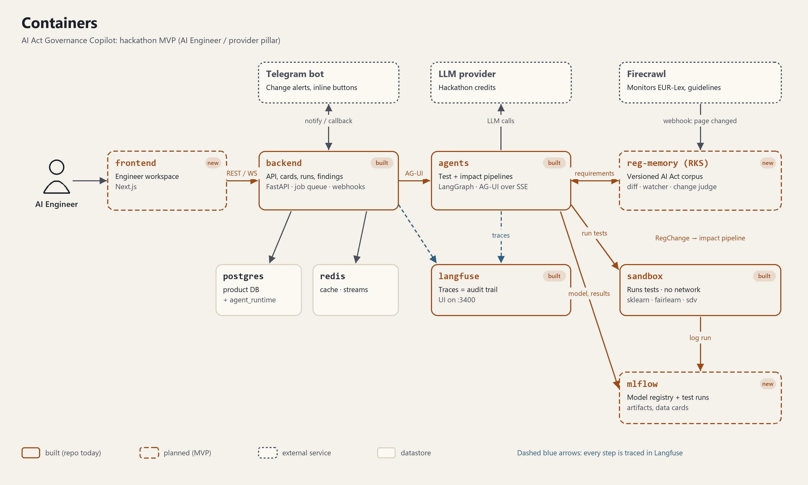
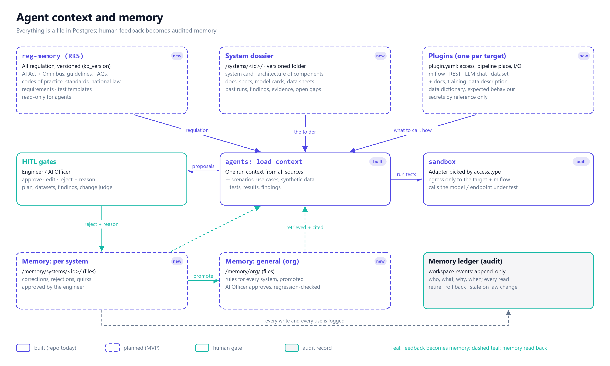
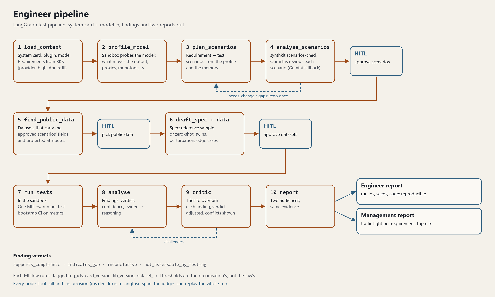
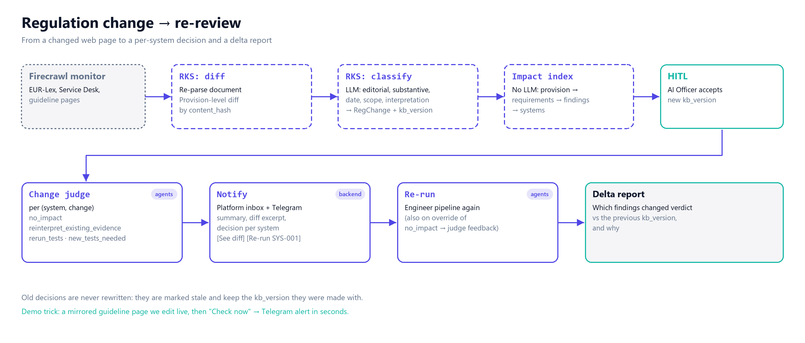
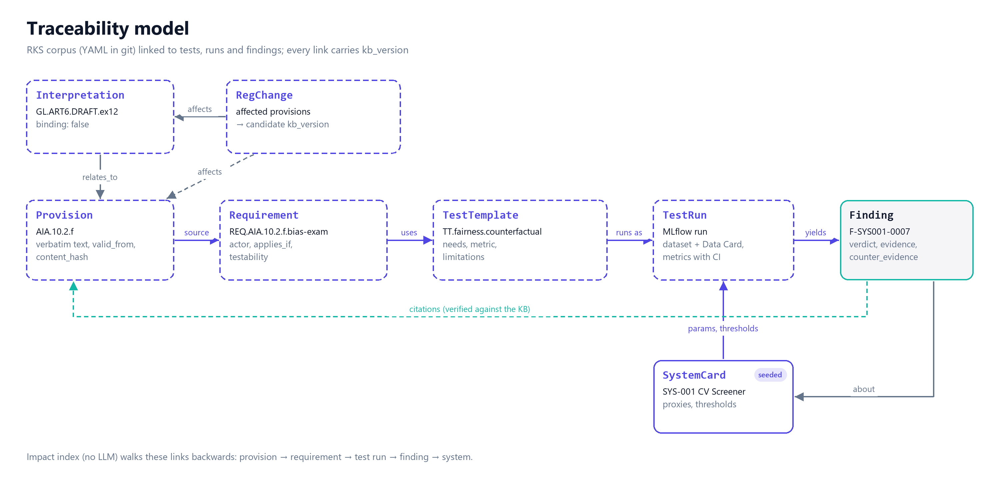

# Architecture

> Keep this page current as the design changes. The full design document (Greek, 24 pages) is
> [ai-act-governance-copilot.pdf](ai-act-governance-copilot.pdf); this page is the English summary
> of what we build. Its §12 (AI Engineer MVP) replaces the earlier scope in §9 and §11.5.
> Diagrams live in [diagrams/](diagrams/) (PNG + SVG); edit `diagrams/build.py` and run
> `scripts/build-diagrams.*` to regenerate them.

## Overview

**AI Act Governance Copilot**: an agentic EU AI Act compliance assistant an organisation runs in-house.
The hackathon MVP covers one pillar only: the **AI engineer of a high-risk system the organisation
builds as a provider**. Given a registered system (a seeded *system card*) and a model in MLflow, the
agent derives the applicable AI Act requirements, plans tests, generates auditable synthetic datasets,
runs the tests in an isolated sandbox, and returns findings with reasoning **and** counter-arguments,
plus an engineer report and a management report. When the regulation or its guidelines change, it
works out which systems are affected and re-runs what is needed.

Design principles (PDF §1):

- **Human in the loop by design**: agents write `proposed` results; only a person makes them `approved`.
- **Every claim has a source** (article / paragraph / Annex / guideline); no source → the agent says it is uncertain.
- **Deterministic skeleton, LLM for judgement**: the order of steps and the rules are code/YAML; the LLM interprets and explains.
- **Versioned law**: every finding locks the `kb_version` it was produced with; a law change triggers impact analysis, never a silent rewrite.

## Roles

Three roles (pillars). There is no login; the roles say who does what, and the app does not enforce them.

| Role | Does | In this build |
| --- | --- | --- |
| **AI Officer** | Oversees all systems, audits, the findings register, regulation changes and their impact | The shared read view: systems list, Status tab (findings register), audits list, regulation inbox. No separate UI or permissions |
| **PM** (product manager) | Registers a system: system card, risk class, documentation | Not built. Systems are seeded (`mnamon/mlflow-seed/cases/`, `POST /v1/admin/import-seed`); `POST /v1/systems` exists but no screen uses it. **Planned:** a small, fast risk-classification agent that proposes the risk class and Annex III basis from a system description, with citations, for a human to approve |
| **AI Engineer** | Adds docs to the system folder, configures one plugin per model, runs audits with human gates | **Built** (the MVP): the pipeline below |

A **plugin** is the wrapper around one model of a system: how the agent reaches it, where it sits in the
system graph, its I/O and expected behaviour ([agent-context.md § 3](agent-context.md#3-plugins-how-to-reach-a-model-what-it-is-what-it-should-do)).
**An audit tests one plugin**: `audit.data.target_plugin` when given, otherwise the decision model (the first
plugin whose name contains `rank`, `scor`, `classif` or `model` and that has `data/data-dictionary.yaml`).

## Layout

The product lives in one folder named after the brand, `mnamon/` (*Mnamon*). Each service is a subfolder with its own Dockerfile, and the folder's `docker-compose.yaml` wraps them all:

```text
mnamon/
├── <service-a>/
│   └── Dockerfile
├── <service-b>/
│   └── Dockerfile
└── docker-compose.yaml
```

## Services

### Running today

The product folder is `mnamon/`, named after the brand. Full table (images, networks, healthchecks): [mnamon/README.md](../../mnamon/README.md).

| Service | Folder | Port (host → container) | Responsibility |
| --- | --- | --- | --- |
| `backend` | `mnamon/backend/` | 8100 → 8000 | FastAPI API; runs `alembic upgrade head` on start: [backend](../services/backend.md) |
| `frontend` | `mnamon/frontend/` | 8080 → 8080 | Engineer workspace (Vite + React SPA, nginx proxies `/api` to the backend): [frontend](../services/frontend.md), [audit workflow](../services/frontend-audit-workflow.md) |
| `agents` | `mnamon/agents/` | not published (8003) | Runs the agents (Google Gemini only, Oumi Iris as the decision model, deep agents, async sub-agents, MCP, sandbox) and streams AG-UI to the backend: [agents service](../services/agents-service.md), [contract](../contracts/agents-contract.md) |
| `postgres` | (image) | not published | Backend database + `agent_runtime` (checkpoints, conversation files, tasks) |
| `redis` | (image) | not published | Backend cache (`volatile-lru`) |
| `reg-memory` | `mnamon/reg-memory/` | not published (8010) | Regulatory Knowledge Service: versioned AI Act corpus, diffs, watcher: [reg-memory](../services/reg-memory.md) |
| `mlflow` + `mlflow-seed` | `mnamon/mlflow/`, `mnamon/mlflow-seed/` | 5500 → 5000 | Model registry + test runs; the one-shot seed job trains and registers the demo models: [mlflow](../services/mlflow.md) |
| `model-gateway` | `mnamon/model-gateway/` | 8200 → 8000 | Seed models as bearer-auth, rate-limited REST endpoints: [model gateway](../services/model-gateway.md) |
| `sandbox_runner` | `mnamon/sandbox/` | not published (8090) | Runs test code and synthkit; reaches only MLflow and the model gateway: [sandbox](../services/sandbox.md) |
| `langfuse-web` + `langfuse-worker` | (images) | 3400 → 3000 | Langfuse v4: trace UI, ingestion API, async processing |
| `langfuse-postgres`, `-clickhouse`, `-redis`, `-minio` | (images) | not published | Langfuse's own datastores |

### MVP containers (PDF §12.2)

All of these run today.



| Container | Role | Tech (proposal) | Maps to |
| --- | --- | --- | --- |
| `frontend` | Engineer workspace: systems, system card, test plan, dataset auditor, findings, reports, regulation-change inbox | Vite + React + Tailwind (nginx) | `frontend`, running |
| `backend` | API, system cards, runs, findings, evidence, notifications, webhooks (Firecrawl, Telegram), job queue | FastAPI + Postgres + Redis | existing `backend` |
| `agent` | Test pipeline and impact pipeline | LangGraph + Google Gemini, Oumi Iris for decisions | existing `agents` |
| `reg-memory` (RKS) | Regulatory Knowledge Service: **all** regulatory knowledge (AI Act, Omnibus, guidelines, FAQs, codes of practice, standards, national law, internal policies), versions, diff, watcher, change judge | FastAPI + versioned `/data` volume + YAML corpus in git | `reg-memory`, running |
| `mlflow` | Tracking server, model registry, artifacts (test runs are logged here) | MLflow + local volume | `mlflow`, running |
| `sandbox` | Runs test code; no network except MLflow; CPU/RAM/time limits | Python image with the ML stack + synthkit | `sandbox_runner`, running |

The sandbox is separate from the agent so LLM-written test code never runs next to credentials or the database.

### Agent context and memory

The agent reads four sources before an audit: `reg-memory` (the rules), the **system dossier** (the folder of
the audited system), **plugins** (one per model or endpoint: a target card with access, pipeline place and expected behaviour, plus
docs and training-data descriptions added at configuration) and **agent memory** (lessons from human corrections,
one shared memory per audited system, used by every step and agent of every audit of it, not shown to users). All
four are files in a virtual filesystem stored in Postgres. Design, paths, tables,
schemas and audit rules: [agent-context.md](agent-context.md).




## Data flow

### Engineer pipeline (PDF §12.5)



The order below is the code (`mnamon/agents/pipeline/graph.py`); step details in
[agents-pipeline.md](../services/agents-pipeline.md). The diagram above may lag behind it.

```text
load_context        system card, target plugin files, kb_version, requirements, findings register
  → pin             kb_version, dossier, config, MLflow model version, seeds
  → ground_obligations   obligation map: which AI Act obligations apply (catalogue + Iris on borderline rows)
  → profile_model   synthkit profile of the model (sandbox)
  → plan_scenarios  every scenario names an obligation
  → analyse_scenarios    deterministic check + Oumi Iris reviews each scenario
  → [gate scenarios]
  → find_public_data     public datasets that fit the approved scenarios
  → [gate public_data]   human picks one, or none
  → draft_spec → generate_data → analyse_datasets   synthetic data + 5 data gates
  → [gate datasets]
  → run_inference   model calls only, hashed per-row predictions, one MLflow run
  → analyse_results metrics from the saved predictions
  → assess_obligations   rule verdict (org thresholds) + Gemini assessor + independent Iris verdict
  → critic          tries to overturn each verdict
  → seal            severity, gap ids, sha256 hash chain, one verdict per obligation
  → report → finalize    engineer + management report; a re-run writes its delta report
```

Finding verdicts: `supports_compliance | indicates_gap | inconclusive | not_assessable_by_testing`.
Fairness thresholds on the system card are **organisational** (`org_thresholds`), not legal; the
AI Act sets no numbers, and findings must say so.

### Regulation change → re-review (PDF §12.6)



```text
Firecrawl monitor (EUR-Lex, Service Desk, guidelines) → webhook → RKS
  → re-parse, provision-level diff by content_hash → LLM classifies change type → RegChange + candidate kb_version
  → impact index (no LLM): provision → requirements → findings/test runs → systems
  → change judge per (system, change): no_impact | reinterpret_existing_evidence | rerun_tests | new_tests_needed
  → notify (inbox + Telegram with inline buttons) → optional re-run → delta report vs previous kb_version
```

Every step is traced in Langfuse, which doubles as the audit trail in the demo.

### RKS corpus (PDF §12.3)

YAML in git, four entities: `provisions/` (verbatim text, `valid_from`, `content_hash`, `kb_version`),
`requirements/` (actor, `applies_if`, modality, testability, `test_templates`), `interpretations/`
(guidelines, `binding: false`), `test_templates/` (`supports`, `needs`, metric, `limitations`).
MVP scope: Art. 6, 9–15, 17, Annex III, Annex IV.



### Seed data (PDF §12.7)

Three dummy ML systems, each a local MLflow model trained by `mlflow-seed` from `mnamon/mlflow-seed/cases/`:

- **SYS-001 CV Screener** (provider, Annex III 4(a)): two models, `cv-parser` → `cv-ranker` → recruiter review; biased through a proxy (postcode ↔ nationality).
- **SYS-002 Credit Scorer** (provider, Annex III 5(b)): nearly clean, the contrast case.
- **SYS-003 Benefits Eligibility Triage** (deployer, Annex III 5(a)): only Art. 4 and 5 apply to a deployer in the obligation catalogue.

No seeded audits: the first audit is run live (`POST /v1/admin/import-seed` loads the systems).

## Open questions (PDF §12.9)

- Whether the Omnibus changed the special-category-data rule for bias detection (former Art. 10(5)); it decides whether tests may use protected attributes.

## Decisions

| Date | Decision | Why |
| --- | --- | --- |
| 2026-11-13 | Services run in Docker, wrapped by one compose file in the product folder | One command starts the whole product, locally and on a server |
| 2026-11-13 | Repo tooling: Python 3.12 + uv, pytest, ruff | Fast, reproducible checks with one lockfile |
| 2026-11-13 | Self-hosted Langfuse v4 in the product compose, with its own Postgres and Valkey | Full traceability without a SaaS; v3 is deprecated; Langfuse's queues need `noeviction` and its migrations stay off the product database |
| 2026-11-14 | Product: AI Act Governance Copilot, MVP = AI Engineer (provider) pillar only | Classification and system card are seeded; the testing + regulation-change loop is the demoable, differentiated part |
| 2026-11-14 | Agent context and memory are files in a Postgres-backed virtual filesystem (`/regulation/`, `/systems/<id>/` with plugins, `/memory/`), append-only and audited | Reuses the agents service's existing file layer; agents read with normal file tools; every write and read is versioned and logged |
| 2026-11-14 | Agent memory is **per system**, owned by the agents service (`system_memories` in `agent_runtime`, `/memory/MEMORY.md` + `audits/<id>/<name>.md`, `remember` / `forget`), not user-visible; org memory, proposals and promotion dropped | One namespace every step and agent shares; the reviewer's reason at a gate becomes a lesson the next run applies, with no extra UI to build |
| 2026-11-14 | LLM = Google Gemini only; decision model = Oumi Iris (scenario review, independent verdict, change judge), Gemini as fallback | Sponsor credits; a second, independent judge for each verdict |
| 2026-11-15 | Plugin = the wrapper around one model, configured in the Plugins tab from the system graph with MLflow defaults; stored as `plugin.yaml`, hidden from the Folder tab | The agents read it as a file; the engineer confirms defaults instead of writing YAML |
| 2026-11-15 | Three roles (AI Officer, PM, AI Engineer); only the AI Engineer pillar is built; no login | Focus the 36 hours on the demoable audit loop |
