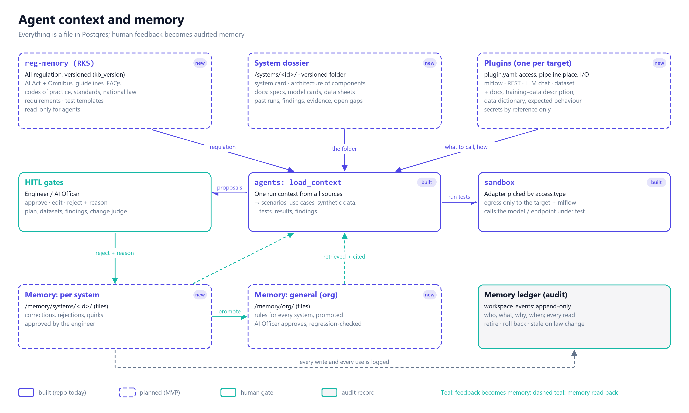

# Agent context and memory

> Status: **design, not built yet**. This page extends the design PDF (§5.5 precedents, §12 MVP) to the
> engineer pipeline. Keep it current as we build.

Before the agent audits a system it needs four things:

1. **The rules:** what the regulation says (`reg-memory`).
2. **The system:** everything known about the system being audited (the **system dossier**, "the folder").
3. **The targets:** one **plugin** per model or endpoint: how to reach it, where it sits in the pipeline,
   what it should do, plus any docs and training-data descriptions added when the plugin was configured.
4. **The lessons:** what the agents learned from human corrections on earlier audits of this system
   (**agent memory**, per system, not user-visible).

All four reach the agent the same way: as **files in a virtual filesystem stored in Postgres** (section 5).
The agent reads them with its normal file tools, and every file has an owner, a version and an audit trail.
`load_context` merges them into one run context. Every later step (scenarios, use cases, synthetic data,
tests, findings) uses it and cites the files it relied on.



## 1. `reg-memory`: all the regulation, in one place

The Regulatory Knowledge Service (RKS) holds **all** regulatory knowledge, versioned as one `kb_version`:

| Content | Binding | Notes |
| --- | --- | --- |
| AI Act, consolidated (post-Omnibus) | yes | Main working text, verbatim, one node per article / paragraph / point |
| Digital Omnibus on AI (Reg. (EU) 2026/1744) | yes | Provenance of amendments and new dates |
| Commission guidelines (AI system definition, prohibited practices, Art. 6) | no | Interpretations and worked examples |
| AI Act Service Desk FAQs, codes of practice | no | Watched for changes |
| Harmonised standards (CEN-CENELEC JTC 21) | n/a | Status and metadata only |
| National implementing law | yes | When available |
| Organisation's internal AI policies | internal | Stored as interpretations with `binding: internal` |
| Requirements, test templates | derived | Extracted from the above, human-checked |

Rules:

- **Agents only read it**, at `/regulation/` pinned to the run's `kb_version`. Changes come only through the
  watcher → diff → HITL accept (see [README § Regulation change](README.md#regulation-change--re-review-pdf-126)).
- Every provision carries `provision_id` + `kb_version`, so every finding can say which text it used.
- Agent memory (section 4) is **not** stored here: the RKS holds what the law says; memory holds how *we* apply it.

## 2. System dossier: "the folder" of an audited system

One versioned folder per system, with everything the agent needs about it. It is mounted read-only at
`/systems/<SYS-ID>/`:

```text
/systems/SYS-001/
├── system-card.yaml          # identity, role, risk class + basis, purpose, deployment, affected persons,
│                             # protected attributes, known proxies, declared metrics, org thresholds
├── architecture.yaml         # components and how they connect (the pipeline graph of plugins)
├── docs/                     # system-level docs: specs, instructions for use, DPIA/FRIA, policies
├── plugins/                  # one folder per configured plugin (section 3)
│   ├── cv-parser/
│   └── ranker/
├── evidence/                 # previous test runs (MLflow refs), findings, reports
└── gaps.yaml                 # open obligations without evidence
```

- **Versioned:** each audit locks `dossier_version` (with `card_version` and `kb_version`); findings record all three.
- **Provenance per fact:** `declared_by_human | extracted_from:<file> | estimated_by_agent`, as in the PDF §5.1.
- **Completeness check first:** if fields that the requirements need are missing, the agent asks for them
  before planning (HITL), instead of guessing.

## 3. Plugins: how to reach a model, what it is, what it should do

A **plugin** connects the agent to one testable thing: a model, an endpoint, an LLM app or a dataset. A system
can have several (a pipeline of models). When an engineer **configures a plugin** they:

1. pick the access type (MLflow model, REST endpoint, LLM chat, batch file, dataset only);
2. fill in the **target card** (`plugin.yaml`): access, place in the pipeline, inputs and outputs, expected behaviour;
3. **add any files the agent should read**: API docs, model card, training-data description, data dictionary,
   evaluation reports, known issues, free-text notes.

Everything is stored as one folder:

```text
/systems/SYS-001/plugins/ranker/
├── plugin.yaml               # the target card (below)
├── README.md                 # plain description: what this model does and why
├── docs/                     # API docs, model card, eval reports, known issues
├── data/
│   ├── training-data.md      # datasheet: sources, period, size, populations, labels, known biases
│   ├── data-dictionary.yaml  # features: type, range, meaning, protected / proxy flags
│   └── sample.csv            # optional synthetic or anonymised sample (never real personal data)
└── notes/                    # anything else the engineer wants the agent to know
```

The target card:

```yaml
# plugin.yaml
id: SYS-001.ranker
system: SYS-001
name: Candidate ranker
card_version: 3

# Where it sits
placement:
  kind: pipeline_stage              # standalone | pipeline_stage | ensemble_member | whole_system
  position: 2 of 3
  upstream: [SYS-001.cv-parser]     # produces this target's input
  downstream: [SYS-001.recruiter-ui]
  pipeline_summary: "CV parser → ranker → recruiter reviews the shortlist"
  end_to_end_entry: SYS-001.cv-parser   # call this one to test the whole chain

# How to reach it
access:
  type: mlflow_model                # mlflow_model | rest | llm_chat | batch_file | dataset_only
  uri: models:/cv-screener/3
  # type: rest
  # url: https://staging.example.internal/rank
  # method: POST
  # auth: {type: bearer, secret_ref: vault://targets/sys-001-ranker}   # a reference, never the secret
  environment: staging              # production needs explicit approval at the test-plan gate
  limits: {rps: 5, max_requests: 5000, timeout_s: 10}

# What goes in and out
io:
  input_schema: data/data-dictionary.yaml   # or from_mlflow_signature, or an inline JSON Schema
  example_input: docs/example-input.json
  output: {type: binary_classification, positive_label: shortlist, score_field: proba}

# What it should do (drives scenarios and pass/fail)
expected_behaviour:
  task: "Rank applicants for engineering roles; a recruiter reviews every shortlist"
  must: ["score in [0, 1]", "same input → same score"]
  must_not: ["use protected attributes directly", "auto-reject without human review"]
  known_limitations: ["CVs not in English are under-scored"]

# Hints for scenario and data generation
scenarios:
  personas: [junior engineer, career returner, non-EU applicant, senior with gaps]
  edge_cases: [missing fields, very long CV, non-English CV, out-of-range years]
  protected_attributes: [sex, age_band, nationality]
  known_proxies: [postcode_region, career_gap_months]
  training_data: data/training-data.md
  reference_sample: mlflow-dataset://cv-sample-v1      # optional, for SDV
  data_policy: synthetic_only                          # never send real personal data
  generation: {mode: zero_shot, seed: 42, min_per_cell: 50, n_max: 5000}   # zero_shot | reference_sample
  metamorphic_relations:                               # optional: "if input changes like X, output must Y"
    - "more years_experience, all else equal → score does not decrease"
```

`data/data-dictionary.yaml` carries the business logic the generator needs: file-level `population`
(stats from the training-data description, used by the realism gate), `rules` (`hard | soft`, whitelisted
expressions, no `eval`) and `label_rule`; per field `role` (`protected | proxy | feature | label | id | surface`),
`proxy_for`, `values` + `distribution`, `range`, `nullable`, `depends_on` + `conditional`, `source`
(Faker/list/LLM text), `monotone`, `provenance`. Full schema and the SYS-001 example:
[synthetic-data.md § 4](synthetic-data.md).

How the agent uses a plugin:

| Step | Reads from the plugin |
| --- | --- |
| `plan_tests` | `placement` (test the stage alone, the whole chain, or both), `expected_behaviour`, `README.md`, `docs/` → which requirements apply and which templates fit |
| `generate_data` | `data/data-dictionary.yaml`, `data/training-data.md`, `example_input`, `scenarios.*`, memory → the LLM drafts a **GenerationSpec** (marginals, causal graph, rules; every item tagged `dictionary \| training_doc \| memory \| llm_assumption`); deterministic code samples, enforces rules and builds counterfactual twins; 5 gates (schema, rules, realism, coverage, privacy) → dataset + `DataCard.yaml` ([synthetic-data.md](synthetic-data.md)) |
| `execute` | `access.type` picks the sandbox adapter (MLflow load, HTTP, LLM chat, batch, dataset-only); `limits` set rate and volume |
| `analyse` / `critic` | `io.output` to read results; `must` / `must_not` as checks; `known_limitations` and the training-data description as counter-evidence ("synthetic population differs from training data") |

Security rules:

- **Secrets are references only** (`secret_ref`). The sandbox runner resolves them; the LLM never sees them,
  and plugin files are checked so no raw credential is stored.
- The sandbox's network egress is allow-listed to the target's host and MLflow only.
- Production endpoints, or anything over `max_requests`, need approval at the test-plan gate (G5).

## 4. Agent memory: per system

> Status: **built** in the agents service ([agents service § Memory](../services/agents-service.md#memory)).
> Replaces the earlier design (org memory, proposals, promote, `MEM-xxxx` ids), which is dropped.

The agent improves from human feedback without retraining. Memory is **per audited system**: every pipeline
step and every agent or sub-agent working on **any audit** of `SYS-00X` shares one memory. It is **not shown to
users** (no UI, no public API); it is the agents' own notebook. Humans steer it indirectly, through the reasons
they give at the gates.

### What the agent sees

Virtual files, rows in the agents service's `agent_runtime` database (nothing on disk):

```text
/memory/MEMORY.md                       derived on every read: one line per entry of the system
                                        (date · step · agent · name — summary), grouped by audit,
                                        newest first; a write to it changes nothing
/memory/audits/<audit_id>/<name>.md     one entry: "# <name>", the one-line summary, the detail
```

- **`MEMORY.md` is in the prompt.** When a run has a `system_id`, the index is loaded when the agent is built
  and injected into the system prompt of the agent and of every sub-agent. Entries are read on demand with
  `read_file`. The agent says which entry it applied (by path), so the trace shows why a plan changed.
- **`remember(name, summary, content)`** writes `/memory/audits/<current audit>/<slug>.md`. The system and the
  audit come from the run config, never from the model. Same name in the same audit = update in place
  (idempotent, safe on a resumed node). Never raises; returns a string. Cap per system
  (`MEMORY_MAX_ENTRIES_PER_SYSTEM`, default 200); updates always go through.
- **`forget(name, audit_id?)`** deletes one entry; approval-gated (HITL) by default.
- `write_file` / `edit_file` may write an entry only in the current audit's folder (same cap). Provenance
  (step, agent, run, thread, trust) lives in **columns only**, never in the body, so the agent cannot rewrite
  its own audit trail. Both tool names are reserved: no MCP tool can shadow them.

### Where lessons come from

| Trigger | Typical entry |
| --- | --- |
| Test-plan gate: test rejected or edited, with a reason | "Don't run adversarial tests on rule-based components" |
| Dataset audit: dataset rejected | "Synthetic ages must match the applicant population (18–67)" |
| Finding overridden by a human | "Gap at ratio 0.78 is inconclusive when the CI crosses 0.8" |
| Change judge overridden | "Changes to Annex III §4 mean `rerun_tests` for this system" |
| Endpoint behaviour discovered during a run | "Ranker returns 429 above 5 rps" |

**Gate contract (the pipeline is built later):** when a human rejects or requests changes at a gate, the
backend records the decision with its `reason_category` and comment (it no longer writes any memory itself).
The pipeline passes that reason to the next agent run of the audit (same `system_id`, `audit_id`, the `step`
being redone), and that agent records the lesson with `remember` before redoing the work. Reason categories:
`wrong_fact`, `wrong_interpretation`, `missing_info`, `wrong_metric`, `unrealistic_data`, `org_policy`, `other`.

### Audit

- **Table** `system_memories` (PK `system_id, audit_id, name`): `summary`, `content_md` (the body, verbatim),
  `step`, `agent_name`, `source_run_id`, `source_thread_id`, `created_by`, `trust_level`, `created_at`,
  `updated_at`. Created on boot (`CREATE TABLE IF NOT EXISTS`), no Alembic.
- **In the trace:** `remember` / `forget` calls are tool spans in Langfuse, and the prompt of every step
  contains the `MEMORY.md` it started from, so a replayed run shows which lessons shaped it.
- **For judges and debugging:** `GET /internal/systems/{id}/memory` on the agents service (internal secret)
  returns the index and every entry with its provenance. Read-only.

## 5. The filesystem (stored in Postgres)

The agents service already exposes Postgres rows as files through one `CompositeBackend`
([agents service § Filesystem](../services/agents-service.md#filesystem)): `/conversation/…` paths are
`conversation_files` rows over encrypted, content-addressed blobs. We add these routes the same way:

| Path the agent sees | Backed by | Agent can write | Who writes it | Versioned |
| --- | --- | --- | --- | --- |
| `/regulation/` | RKS corpus, pinned to the run's `kb_version` | no | watcher + HITL (RKS) | per `kb_version` |
| `/systems/<SYS-ID>/` | `workspace_files`, namespace `system:<id>` | no | PM / AI Officer / engineer (UI, uploads) | per `dossier_version` |
| `/systems/<SYS-ID>/plugins/<plugin>/` | `workspace_files`, namespace `system:<id>`, paths under `plugins/<plugin>/` | no | engineer, when configuring the plugin | per `card_version` |
| `/memory/MEMORY.md` | derived from `system_memories` rows (agents service, `agent_runtime`) | no (writes ignored) | nobody: generated on read | always current |
| `/memory/audits/<audit_id>/<name>.md` | `system_memories` row `(system_id, audit_id, name)` | **yes**, own audit only (`remember`, `write_file`) | agents of any audit of the system | updated in place |
| `/conversation/…`, scratch | existing tables (unchanged) | as today | as today | as today |

Tables (backend Postgres, migration `0003_systems_audits`; built, see
[backend systems](../services/backend-systems.md) for the routes):

| Table | Holds |
| --- | --- |
| `workspace_file_blobs` | Content once per hash (`sha256`), plain bytes like conversation blobs (encryption at rest: later) |
| `workspace_files` | `(namespace, path, version)` → blob, plus `content_type`, `created_by`, `created_at`, `is_current`. A new version is a new row; old rows stay |
| `workspace_file_meta` | *Not built yet:* indexed fields parsed from structured files and a pgvector embedding. Until then, per-version metadata lives in `workspace_files.data` (JSONB) |
| `workspace_events` | Append-only audit ledger: `(namespace, path, version, action, actor, reason, run_id, trace_id, at)`. Actions today: `create`, `update`, `delete`, `read` (with `audit_id`); `approve`, `stale` next |
| `systems` | One audited system (`SYS-001`): `name`, `status`, JSONB `data` (parsed system card). Not scoped by client id |
| `audits` | One audit of a system: `status`, `stage`, JSONB `data` (`dossier_version` locked at creation, `plugin_ids`, `kb_version`) |
| `audit_artifacts` | Every stage output, versioned per `(audit, kind, name)`; `status` proposed / approved / rejected / changes_requested / superseded; JSONB `data` + `file_refs` |
| `approvals` | Every human gate decision: `gate`, `decision`, `reason_category`, `comment`, `edits`, `decided_by`. The reason goes to the next agent run, which records the lesson with `remember` |

- **Mounting:** the backend passes `system_id` (and `audit_id`, `step`) in the run's config; the agents
  service mounts `/memory/` for that system (built) and `/systems/<id>/` and `/regulation/` (not yet). A run
  never sees another system's files or memory.
- **Pinning:** a run reads the versions current at its start and records them in the trace, so a replay sees
  exactly the same files.
- **Reads are logged** (`read` events), so the audit can show which files an audit actually used.
- **Uploads:** files added in the UI (plugin docs, training-data descriptions) go through the same checks as
  conversation uploads (hash, size limit, safe names), then into `workspace_files`.

## Demo moment

1. The engineer configures the `ranker` plugin: picks MLflow, fills the card, uploads the training-data
   description. The agent generates personas and counterfactual twins that match that population.
2. They reject a fairness test on SYS-001 ("wrong metric for hiring"). The pipeline hands the reason to the
   planner, which calls `remember` → `/memory/audits/<audit>/wrong-fairness-metric.md`, then re-plans.
3. The next audit of SYS-001 starts with that line in its `MEMORY.md`; the plan cites the entry, and the
   Langfuse trace shows the `remember` call, the reviewer's reason and the prompt that carried it.

## Open questions

- Should a lesson ever apply across systems (an org-wide memory), and who would approve it?
- Do quirks discovered automatically need a human look, or only a notification?
- Does `/regulation/` read from RKS through an API at mount time, or does the RKS publish each `kb_version` into `workspace_files`?
