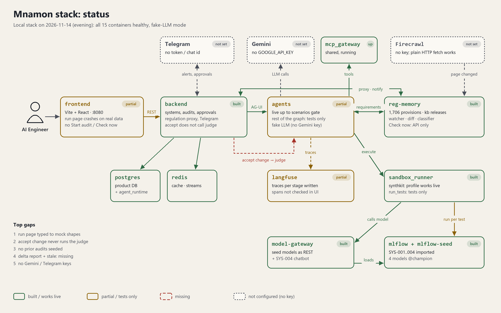
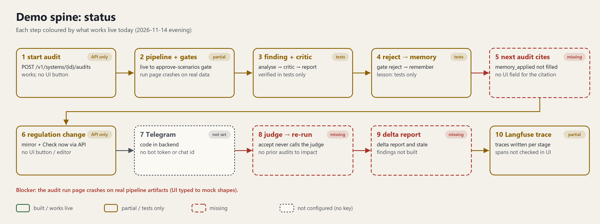
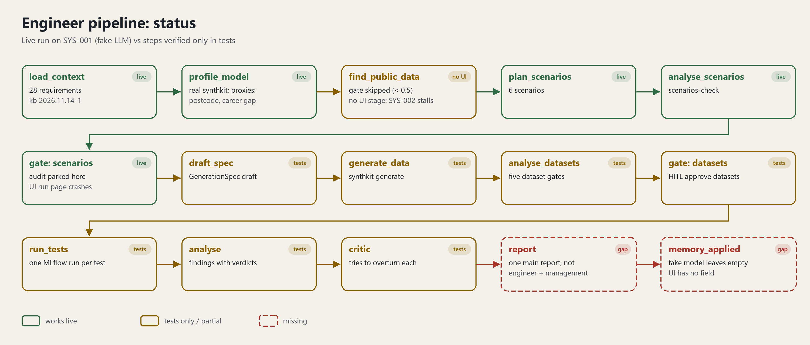

# Mnamon: project status

> **2026-11-14, evening** (audit about 21:30, re-checked against the running stack). Code freeze: **Sun 15 Nov 18:00**.
> Draft for the team, not authoritative. Diagrams: `uv run python docs/draft/status/build.py`.

## What's going on

- **Mnamon** (the AI Act Governance Copilot) runs locally as 15 healthy containers, in **fake-LLM mode** (no Google key in `.env`).
- The audit pipeline runs **live on SYS-001** from `load_context` to the **"approve scenarios" gate** and parks there. Everything after the gate passes in tests but has not run live.
- reg-memory, backend, MLflow seed, branding and CI/CD are built.
- **The blocker is the frontend**: the audit run page crashes on real pipeline data, so the demo cannot be shown in the UI yet.
- The regulation-change half of the demo (judge, re-run, delta report, Telegram) is not wired end to end.

## Current flow (what a user can do today)

| # | Step | Live | Tests only | Missing |
| --- | --- | --- | --- | --- |
| 1 | Open Systems, pick SYS-001..004 | List and detail load | | Cards show "Unclassified": the UI reads `data.risk_class`, the backend sends `data.card.risk_class` |
| 2 | Start an audit | `POST /v1/systems/{id}/audits` starts the pipeline | | No "Start audit" button |
| 3 | Pipeline to the scenarios gate | load_context (28 reqs, kb `2026.11.14-1`) → profile_model (real synthkit: postcode→nationality, career gap→sex/age) → find_public_data (gate skipped, score < 0.5) → plan_scenarios (6) → analyse_scenarios → parked | | UI has no find_public_data stage or gate (SYS-002 would stall) |
| 4 | Watch the run, approve the gate | Approvals API works | | **Run page crashes on real artifacts** (typed to mock shapes; pipeline writes different snake_case shapes) |
| 5 | Datasets, tests, findings, critic, report | | draft_spec → generate_data → analyse_datasets → datasets gate → run_tests (MLflow run per test) → analyse → critic → report | Report is one `main`, not engineer + management |
| 6 | Reject a gate → lesson remembered | | `remember` lesson | |
| 7 | Next audit cites the lesson | | | Fake model leaves `memory_applied` empty; no UI field |
| 8 | Regulation change ("Check now") | reg-memory: watcher, content-hash diff, classifier, 1,706 provisions, immutable releases; mirror + check-now via API | | No "Check now" button, no mirror editor (docker exec script today) |
| 9 | Accept change → judge → re-run | Accept is recorded | Change judge → re-run audits | Accept never calls the judge (`mnamon/backend/utils/regulation.py` `decide_change`); no completed prior audits seeded, so the impact index finds nothing |
| 10 | Telegram alert | | Backend code exists | No bot token / chat id |
| 11 | Delta report, `stale` findings | | | Not built |
| 12 | Langfuse trace | Traces written per stage (`stageTraces`) | | Spans not checked in the Langfuse UI |

## What's missing (ranked by demo impact, then effort)

| Rank | Gap | Demo impact | Effort | Where |
| --- | --- | --- | --- | --- |
| 1 | Run page crashes on real artifacts; adapt the UI to the real shapes | **Blocker** | M | `mnamon/frontend` audit feature |
| 2 | "Start audit" button | High | S | `mnamon/frontend` systems |
| 3 | `risk_class` read from `data.card.*` | High (first screen) | S | `mnamon/frontend` systems, home |
| 4 | Accept RegChange → call the change judge | High | S | `mnamon/backend/utils/regulation.py` |
| 5 | Seed completed prior audits + findings (SYS-001, SYS-002) | High (impact index empty) | M | backend seed import |
| 6 | Run the full pipeline live past the scenarios gate | High | M | agents, needs a Gemini key |
| 7 | "Check now" button + mirror edit in the UI | High | S–M | `mnamon/frontend` regulation |
| 8 | Delta report + `stale` findings | High (demo ending) | L | agents + backend + UI |
| 9 | Memory citation: fill `memory_applied`, show it on the step | Medium | M | agents prompts + UI |
| 10 | Telegram token + chat id | Medium | S (config) | `.env`, `docs/guides/telegram.md` |
| 11 | find_public_data stage + gate in the UI | Medium (SYS-002 only) | S | `mnamon/frontend` audit feature |
| 12 | Engineer + management reports instead of one `main` | Medium | M | agents report step + UI |
| 13 | Check Langfuse spans in the UI | Medium (proof for judges) | S | Langfuse :3400 |
| 14 | reg-memory 404s for `gpsr-2023-988`; backend `task_reconcile_fetch_failed` at start | Low | S | reg-memory catalog, backend |

S = under 1 h, M = 1–3 h, L = more than 3 h (estimates).

## What's next

| When | Do |
| --- | --- |
| Tonight | Fix #1, #2, #3: an audit can be started and watched in the UI end to end |
| Tonight | Put a Google key in `.env`, run SYS-001 live through every gate; fix what breaks |
| Sun morning | #4 + #5: accept change → judge → re-run, on seeded prior audits |
| Sun morning | #7 + #10: Check now from the UI, Telegram alert |
| Sun midday | #8 delta report (or a thin version), #9 memory citation |
| Sun afternoon | Verify Langfuse spans, record the demo video, freeze at 18:00 |
| Any time | One-time Dennis setup for CD: `docs/guides/deploy-denis.md` |

## Built (for reference)

| Area | State |
| --- | --- |
| Containers | All 15 healthy (frontend, backend, agents, reg-memory, sandbox_runner, model-gateway, mlflow, Postgres, Redis, Langfuse ×6) |
| Seed | SYS-001..004 imported, 4 models `@champion` in MLflow |
| Branding | Mnamon logo, palette, favicons, deck, diagrams |
| CI/CD | `.github/workflows/pipeline.yml` → `ci.yml` (CI jobs) then `cd.yml` (`cd-images` / `cd-deploy`) to Dennis (deploy repo + Portainer); needs one-time setup |
