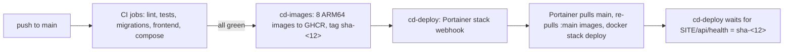

# Deploying to Dennis (CI/CD)

`.github/workflows/pipeline.yml` (workflow **CI/CD**) has two stages, shown as two
boxes: **CI** (`ci.yml`, reusable: one job per service, on every push and pull
request) and **CD** (`cd.yml`, reusable: on `main` only, after CI passed). CD
builds the ARM64 images, publishes them to the repo owner's GHCR as `:main`
(and `:sha-<12>`) and calls the Portainer webhook. Portainer reads
`deploy/denis/docker-compose-denis.yaml` straight from `main` and re-pulls the
images. No deploy branch, no deploy repo, no bot commits.

The deploying repo is `konstantinosmpouros/genai-summit-2026` (git remote
`origin`; the team repo `EXARTeo/genAI-summit` is remote `exarteo`). CD uses
only the built-in `GITHUB_TOKEN`: **no personal token is stored in GitHub.**
The owner's own token is entered only in Portainer, to pull the private repo.

## What runs on Dennis

The product stack minus what Dennis already has: no Langfuse (it uses Dennis'
Langfuse over the `langfuse` overlay) and no published ports (the frontend is
reached through Nginx Proxy Manager on the `proxy` overlay; MCP tools come from
Dennis' `mcp_gateway`). Our own `sandbox_runner` runs inside the stack.

| Service | Memory limit |
| --- | --- |
| frontend | 128 MB |
| backend, reg-memory | 768 MB each |
| agents | 2 GB |
| mlflow, model-gateway, postgres | 1 GB each |
| sandbox_runner | 4 GB |
| redis | 320 MB |
| mlflow-seed | one-shot |

About 11 GB at the limits; Dennis had 18 GB available on 2026-11-14.

## One-time setup

### 1. Push the code to the deploying repo

`git push -u origin main` (remote `origin` = `konstantinosmpouros/genai-summit-2026`).

### 2. GitHub settings on `konstantinosmpouros/genai-summit-2026`

Settings → Actions → General → Workflow permissions: **Read and write
permissions**. Create the environment **`production`** (Settings →
Environments), deployment branches: `main` only.

| Kind | Name | Value |
| --- | --- | --- |
| Environment secret | `PORTAINER_WEBHOOK_URL` | from step 5 |
| Repository variable | `DENIS_DEPLOY_ENABLED` | `true` (CD is skipped until set) |
| Repository variable | `DENIS_SITE_URL` | public URL, e.g. `https://mnamon.magenticx.com` |
| Repository variable | `DENIS_LANGFUSE_URL` | Dennis' Langfuse UI URL (baked into the frontend's trace links) |
| Repository variable | `DENIS_LANGFUSE_PROJECT_ID` | the project id from step 4 |
| Repository variable | `CD_RUNNER` | optional: `ubuntu-24.04-arm` to build natively (public repos, or a plan with ARM runners); default cross-builds on `ubuntu-latest` with QEMU, slower |

### 3. (reserved)

No token step: CD uses the built-in `GITHUB_TOKEN`.

### 4. Langfuse on Dennis

In Dennis' Langfuse create a project (e.g. `genai-summit`) and an API key pair:
these are `LANGFUSE_PUBLIC_KEY` / `LANGFUSE_SECRET_KEY` below, and its id is
`DENIS_LANGFUSE_PROJECT_ID`.

### 5. Portainer stack (Dennis)

Stacks → Add stack → **Repository**:

| Field | Value |
| --- | --- |
| Name | `genai-summit` |
| Repository URL | `https://github.com/konstantinosmpouros/genai-summit-2026` |
| Reference | `refs/heads/main` |
| Compose path | `deploy/denis/docker-compose-denis.yaml` |
| Authentication | on: your GitHub user + your own token (`repo` read; entered only here) |
| GitOps updates | on, mechanism **Webhook**: copy the URL into `PORTAINER_WEBHOOK_URL` |
| Environment variables | the table below |

GHCR: Portainer → Registries must have `ghcr.io` with credentials that can pull
`ghcr.io/konstantinosmpouros/*` (the mAgenticX images already need this).

The stack's first deploy needs the images, so run CD once first (push to main
or Actions → CI/CD → Run workflow), then create the stack.

| Variable | Required | Value |
| --- | --- | --- |
| `SITE_URL` | yes | same as `DENIS_SITE_URL` (CORS + links) |
| `GOOGLE_API_KEY` | yes | Gemini |
| `POSTGRES_PASSWORD`, `REDIS_PASSWORD` | yes | `openssl rand -hex 32` |
| `AGENTS_INTERNAL_SECRET`, `REG_MEMORY_INTERNAL_SECRET`, `MODEL_GATEWAY_TOKEN`, `LOG_REDACTION_SECRET` | yes | `openssl rand -hex 32` each |
| `LANGGRAPH_AES_KEY` | yes | exactly 32 chars: `openssl rand -hex 16`; never change it once data exists |
| `LANGFUSE_PUBLIC_KEY`, `LANGFUSE_SECRET_KEY` | yes | step 4 |
| `GEMINI_MODEL`, `FIRECRAWL_API_KEY`, `OUMI_API_KEY`, `TELEGRAM_*` | no | as in `.env.example` |

A missing required variable makes the deploy fail (`${VAR:?}`), never start
half-configured.

### 6. Public hostname

- Cloudflare: CNAME `audit` → `lab.magenticx.com` (proxied), like the other subdomains.
- Nginx Proxy Manager: proxy host `audit.magenticx.com` → `http://genai-summit_frontend:8080`,
  websockets **on**, SSL with the shared `npm-1` certificate. Scope the change to
  this hostname only: NPM serves every project on Dennis.

## Day to day

Push to `main`: CI, then CD deploys automatically. A run is skipped while
`DENIS_DEPLOY_ENABLED` isn't `true`. To redeploy without a code change: Actions
→ CI/CD → Run workflow on `main`. A failed update rolls back by itself
(`failure_action: rollback`). Dennis is inspection-only over SSH: every change
goes through this pipeline.

## Known limits

- Secrets are Portainer stack environment variables, not Swarm secrets (faster to
  set up for the hackathon). Move them to Swarm secrets (`*_FILE`) afterwards.
- Cross-building the ML images under QEMU is slow on the first run (layer cache
  in GitHub Actions makes later runs faster).
- Actions are pinned to major tags, not commit SHAs.
