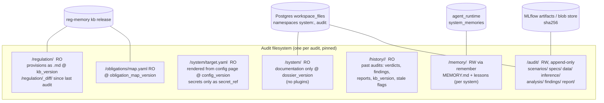

# Plan 01: Obligation-driven audit pipeline for the AI engineer

Status: proposed (2026-11-15). Owner: Mnamon team.
Scope: the engineer pipeline (Start audit → report), the agents' filesystem, the obligation mapping, regulation versions and change, the chat copilot. Plugin configuration is handled in a separate workstream (config page) and is only consumed here.

---

## 0. In one paragraph

An AI engineer picks a high-risk system their organisation **provides** and starts an audit. The pipeline pins everything (documentation version, regulation version, target config), works out **which obligations apply** to this system (role × classification × Annex III point × features × date), plans test scenarios **only for the obligations that can be tested on the model**, sources data (uploaded, public via Firecrawl, or synthetic in the sandbox), calls the model through the local MLflow wrapper, **saves every raw prediction before anyone analyses it**, lets an analyst agent write and run its own code over those saved predictions in the sandbox, and then judges each obligation against the pinned regulation, with **Oumi Iris as an independent judge** next to Gemini. Every applicable obligation ends with exactly one verdict (pass, partial, gap, not applicable, not assessable by testing). Gaps are **sealed and cannot be edited**. Every audit ends with a report, even a failed one. The chat copilot can read all of it: which regulation version an audit used, its results, findings and decisions, and whether it needs a re-run.

---

## 1. Principles (non-negotiable)

| # | Principle | What it means in code |
|---|---|---|
| P1 | **Obligations drive everything** | Scenarios, tests, verdicts and the report are keyed by obligation id. No scenario without an obligation; no applicable obligation without a verdict. |
| P2 | **Regulation is used twice** | At the start: version diff, obligation mapping, scope of scenarios. At the end: verdict per obligation, cited from the same pinned version. |
| P3 | **Pin, then read** | An audit pins `kb_version`, `dossier_version`, `config_version`, `obligation_map_version`, model URI + alias resolved to a concrete model version, seeds. Every read during the audit uses the pins. |
| P4 | **Save raw before analysing** | Inference writes per-row predictions to an immutable, hashed file first. Analysis only reads those files. |
| P5 | **Sealed findings** | Findings and gaps are append-only. Humans annotate or contest; they never edit. A regulation change marks old verdicts `stale` with a new record; it never rewrites them. |
| P6 | **Deterministic skeleton, LLM for judgement** | Graph order, gates, metrics, thresholds and coverage checks are code. LLMs plan, explain, and judge where judgement is needed, and are always checked by code or by a second model. |
| P7 | **Two judges for verdicts** | Gemini proposes, Oumi Iris decides independently, code compares. Disagreement → `inconclusive` + flagged for a human, never silently resolved. |
| P8 | **Every audit ends with a report** | `completed` → full report. `failed` / `stopped` → an "incomplete audit report" that says what ran, what didn't, and why. |
| P9 | **Provider, not deployer** | Obligations are the provider's (Art. 9–17, 43, 47–49, 72–73, 50(1)/(2)). Deployer duties (Art. 26, 27, 86) appear only as "what your customers will ask you for" in an export. |
| P10 | **Thresholds are the organisation's** | The law sets no fairness thresholds. Every pass/fail cites the org threshold from the system card and says so. |

---

## 2. Who uses what (MVP vs full scale)

```mermaid
flowchart LR
  subgraph PM["PM / AI Officer (full scale, later)"]
    R[Register AI system] --> C[Classification + role\nrisk-category report]
    C --> OM[Obligation map\napproved]
    OM --> CFG[Target configs\n(config page)]
  end
  subgraph ENG["AI engineer (MVP)"]
    SA[Start audit\nwizard or chat] --> RUN[Audit run\ngates + live graph]
    RUN --> REP[Report + sealed gaps]
    REP --> CH[Ask the copilot]
  end
  OM -. consumed .-> SA
  CFG -. consumed .-> SA
```

MVP: the seed data stands in for the PM side (system card, classification, org thresholds, an approved obligation map per system). The engineer only tests.

---

## 3. The obligation layer (new, central)

### 3.1 Why it changes the pipeline

Today the pipeline loads a flat list of 28 "requirements" (15 testable) from `reg-memory/corpus/requirements.yaml`. The Annex III point is ignored, Art. 50 features are never passed, documentation obligations get no verdict, and nothing records *why* an obligation applies. The obligation map fixes all four and becomes the backbone: **scope → scenarios → tests → verdicts → report** are all indexed by it.

### 3.2 Obligation catalogue (reg-memory, versioned with the kb)

Method: the two-key activation used in professional AI Act gap analyses (role × classification, then effective date), extended with a **verification mode** that those analyses lack because they excluded technical testing.

```yaml
# reg-memory/corpus/obligations.yaml  (snapshotted into every kb release)
- id: OBL.AIA.15.1.accuracy
  article: AIA.15.1            # provision id in the kb
  related: [AIA.15.3, AIA.13.3.b.ii]
  addressee: provider
  applies_if:
    risk_class: [high]
    basis_any: [annex_iii, annex_i]        # family
    annex_points_any: []                   # empty = all points
    features_any: []                       # e.g. [interacts_with_people] for 50(1)
    exempt_6_3: false
  in_force:                                 # post-Omnibus dates, per basis
    annex_iii: 2027-12-02
    annex_i: 2028-08-02
  verification_mode: model_test             # model_test | system_test | hybrid | documentary
  checks:                                    # what a test must establish
    - metric_family: accuracy
      templates: [TT.accuracy.overall, TT.accuracy.subgroup]
      threshold_source: org_thresholds.accuracy_min
  evidence_types: [testing_protocols_reports, technical_documentation]
  severity_rule: by_in_force_date           # see 7.3
  summary: "Appropriate level of accuracy, declared in the instructions for use"
```

| Verification mode | Obligations (provider, high-risk) | Pipeline output |
|---|---|---|
| `model_test` | 10(2)(f),(g) bias examination · 10(3),(4) representativeness · 15(1),(3) accuracy · 15(4) robustness · 15(5) adversarial · 50(2) marking (if generative) | Metrics with CI vs org threshold → verdict |
| `system_test` | 12 logging · 14(4) override/stop/interpretability · 13(3)(b) declared limits vs observed · 9(6)–(8) testing against predefined metrics | Checks on the system/config + observed behaviour → verdict |
| `hybrid` | 9 risk file · 11 + Annex IV §2–3 · 13 instructions (accuracy section) · 72 PMM plan (KPI baselines) | Generated document sections from test evidence; verdict on presence + consistency |
| `documentary` | 4 · 5 · 16 (b)–(l) · 17 QMS · 18 · 20 · 21 · 22 · 43 · 47 · 48 · 49 · 73 | Verdict `not_assessable_by_testing` + evidence-gap check against the dossier (is the document there?) |

### 3.3 System obligation map (per system, then pinned per audit)

```mermaid
flowchart LR
  CARD[system-card.yaml\nrole, risk class,\nAnnex III point, features,\n6(3) claim] --> ACT
  CAT[obligations.yaml\n@ kb_version] --> ACT
  ACT[activate\n(code, deterministic)] --> DRAFT[draft map\napplicable / not + reason]
  DRAFT --> BORDER{borderline?\n6(3) claim, features,\nAnnex point}
  BORDER -- no --> MAP
  BORDER -- yes --> SCOPER[deep agent: scoper\nreads /regulation + /system docs\nwrites reasoning + citations]
  SCOPER --> IRIS1[Oumi Iris\napplicability decision]
  IRIS1 --> MAP[obligation_map.yaml\nversioned, hashed]
  MAP --> HUMAN[PM approves\n(MVP: seeded as approved)]
```

- **System level** (`obligation_map` in the backend, versioned): set by the PM/AI Officer at registration; the engineer reads it, cannot change it.
- **Audit level**: at `ground_obligations` the system map is re-resolved against the audit's pinned `kb_version`. If the result differs from the approved system map (new obligation, changed date), the audit shows it in its context artifact and the change goes to the PM inbox; the audit proceeds on the **re-resolved** map and says so in the report.
- Each entry: `obligation_id, applicable, reason, in_force_date, in_force_now, verification_mode, checks, citations[], decided_by (rule | iris | human)`.

---

## 4. The agents' filesystem (deepagents `CompositeBackend`)

Today pipeline steps get **no backend** (ephemeral state files) and read everything through HTTP tools; reads of the dossier are live, not pinned. New: every node that runs a deep agent gets the same composite filesystem, built from the audit's pins.



| Mount | Backed by | RO/RW | Who writes |
|---|---|---|---|
| `/regulation/` | reg-memory release `kb_version` (provisions rendered to markdown, + `_diff/` vs the system's last audit kb) | RO | nobody |
| `/system/` | backend `workspace_files` `system:<id>` **at `dossier_version`** | RO | PM / engineer via the system page, never the pipeline |
| `/system/target.yaml` | config page store @ `config_version`, rendered to the plugin.yaml shape synthkit expects | RO | config page |
| `/obligations/` | audit-level map | RO | `ground_obligations` node only |
| `/history/` | past `audit_artifacts` of this system, rendered as files | RO | nobody |
| `/memory/` | `system_memories` | RW only through `remember` (forget is HITL) | any deep-agent node |
| `/audit/` | backend `workspace_files` `audit:<id>`; large files (datasets, predictions) as blobs/MLflow artifacts referenced by sha256 | RW **append-only**: a path once committed by a node cannot be overwritten, a redo writes `v2` | the node that owns the folder |

Implementation: extend the agents service's existing `CompositeBackend` builder (`harness/filesystem/workspace.py`) with `/regulation`, `/system`, `/obligations`, `/history`, `/audit` routes, and pass `backend=` to `create_deep_agent` in `pipeline/steps.py`. Backend gets `GET /internal/systems/{id}/files?version=` honoured (today `version=None` serves the current file) and an `audit:<id>` namespace with an append-only flag.

---

## 5. Graph or one deep agent?

**A graph, with deep agents inside some nodes.** One deep agent would be simpler to write but cannot guarantee order, gates, pinning, resumability, coverage or an audit trail a regulator accepts. The graph owns those; the deep agents own judgement.

| Concern | Owner |
|---|---|
| Order, gates (HITL `interrupt`), retries, resume from checkpoint, redo budgets | LangGraph `StateGraph` + Postgres checkpointer |
| Pins, coverage invariant, metrics, thresholds, sealing | code nodes |
| Open-ended work (scope borderline obligations, design scenarios, find data, write a spec, analyse results with code, explain a verdict, criticise, write the report) | deep-agent nodes |
| Independent decisions (applicability, scenario fit, dataset fit, verdict, change impact) | Oumi Iris, compared with Gemini by code |

**State carries references, not blobs.** Deep agents hand work to each other through files in `/audit/` plus a typed pointer in the graph state:

```python
class AuditState(TypedDict):
    audit_id: str
    pins: Pins  # kb_version, dossier_version, config_version, model_version, seeds
    obligation_map: Ref  # /obligations/map.yaml + sha256
    scenarios: Ref | None  # /audit/scenarios/v{n}.yaml
    data_plan: Ref | None
    datasets: list[DatasetRef]  # sha256, rows, source, card path
    inference: list[InferenceRef]  # per test: predictions path, sha256, model_version, n_rows
    analysis: Ref | None  # metrics + the analyst's code, outputs
    verdicts: Ref | None  # proposed (pre-seal)
    findings: list[str]  # sealed finding ids
    report: Ref | None
    gates: dict[str, GateState]
    redo: dict[str, int]
    errors: list[NodeError]  # tool errors as data, never a crash
```

Each deep agent returns a **result contract** (pydantic, via `response_format`) that names the files it wrote; a code verifier checks the files exist, parse, and match the contract before the graph moves on.

---

## 6. The pipeline

### 6.1 Overview

```mermaid
flowchart TB
  START([Start audit\nwizard or chat]) --> I0

  subgraph P0["Phase 0 · Intake"]
    I0[intake\nvalidate request,\nmode, dataset source] --> I1[pin\nkb, dossier, config,\nmodel version, seeds]
  end

  subgraph P1["Phase 1 · Ground (regulation at the start)"]
    I1 --> G1[mount filesystem]
    G1 --> G2[regulation_diff\nkb of last audit → now\nchanges touching this system]
    G2 --> G3[ground_obligations\nactivate + scoper agent\n+ Iris on borderline]
    G3 --> G4[profile_model\nsandbox: proxies, outputs]
  end

  subgraph P2["Phase 2 · Plan"]
    G4 --> PL1[plan_scenarios\ndeep agent: test designer\nmodel_test + system_test obligations only]
    PL1 --> PL2[review_scenarios\nOumi Iris per scenario\n+ coverage check (code)]
    PL2 -- needs_change, budget left --> PL1
    PL2 --> GATE1{{Gate A\napprove scenarios\nengineer can add own}}
  end

  subgraph P3["Phase 3 · Data"]
    GATE1 --> D1[source_data\nupload · public (Firecrawl) · synthetic]
    D1 --> GATE2{{Gate B\npick dataset source\nonly if candidates}}
    GATE2 --> D2[draft_spec\ndeep agent]
    D2 --> D3[generate_data\nsandbox synthkit\nsaved, hashed]
    D3 --> D4[qa_datasets\nsandbox checks\n+ Iris fit-for-purpose]
    D4 --> GATE3{{Gate C\napprove datasets}}
  end

  subgraph P4["Phase 4 · Execute"]
    GATE3 --> E1[run_inference\nsandbox + modelaccess\nMLflow local model via target.yaml\nRAW predictions saved first]
    E1 --> E2[analyse_results\ndeep agent: analyst\nwrites + runs own code in sandbox\nover saved predictions]
  end

  subgraph P5["Phase 5 · Judge (regulation at the end)"]
    E2 --> J1[assess_obligations\nrule verdict (code)\n+ assessor agent explains\n+ Iris independent verdict]
    J1 --> J2[critic\ndeep agent tries to overturn]
    J2 --> J3[seal\nimmutable findings + gap ids\ncoverage invariant]
  end

  subgraph P6["Phase 6 · Report + learn"]
    J3 --> R1[report\nengineer · management ·\nAnnex IV §2-3 draft ·\nevidence register]
    R1 --> R2[learn\nremember lessons\nupdate system status]
    R2 --> GATE4{{Gate D\nengineer signs off\n(no edits)}}
  end

  GATE4 --> DONE([completed])
  P0 & P1 & P2 & P3 & P4 & P5 -. unrecoverable error .-> FAIL[incomplete report\n+ status failed]
```

### 6.2 Node by node

| # | Node | Kind | Reads | Writes | Notes / checks |
|---|---|---|---|---|---|
| 0.1 | `intake` | code | request | `/audit/intake.yaml` | Mode: `full` · `focused` (engineer picks obligations) · `custom` (engineer's own scenarios and/or dataset). Validates the target config exists and the model alias resolves. |
| 0.2 | `pin` | code | backend, reg-memory, MLflow | audit row `pins` | Resolves `@champion` to a concrete model version; records `kb_version` (default active), `dossier_version`, `config_version`, seeds. **Written back to the audit row** (today kb is not). |
| 1.1 | `mount` | code | pins | — | Builds the composite backend (§4). |
| 1.2 | `regulation_diff` | code + Gemini summary | `/history` (last audit's kb), reg-memory diff API | `/audit/context/regulation-diff.md` | Lists provisions changed since the system's last audit **that appear in its obligation map**. Feeds scoping and the report ("tested against kb X; since last audit, Art. 10(5) moved to 4a"). |
| 1.3 | `ground_obligations` | code → deep agent `scoper` → Iris | card, catalogue, `/regulation`, `/system` | `/obligations/map.yaml` | Deterministic activation first; the agent only handles borderline rows; Iris decides; code checks every catalogue row has a decision. |
| 1.4 | `profile_model` | sandbox code | `target.yaml`, sample | `/audit/context/model-profile.json` | As today (synthkit profile): proxies, output types. |
| 2.1 | `plan_scenarios` | deep agent `test-designer` (reasoning model) | map, profile, `/memory`, `/history`, `/regulation` | `/audit/scenarios/v{n}.yaml` | One or more scenarios per `model_test`/`system_test` obligation; each names obligation id, template, metric, threshold source, data need, protected attributes and proxies. Engineer-provided scenarios (mode `custom`) are merged and marked `source: engineer`. |
| 2.2 | `review_scenarios` | **Oumi Iris** per scenario + code | scenarios, map | `/audit/scenarios/review-v{n}.json` | Iris: `relevant · adequate · needs_change` with probabilities. Code: **coverage** (every testable obligation has ≥ 1 approved-candidate scenario or an explicit `not_testable_reason`), id format, template exists. Auto-redo once. |
| A | Gate A | HITL | — | approval record | Approve / request changes (reason → memory lesson) / add a scenario. Edits are **applied as a new version**, not ignored (today they are ignored). |
| 3.1 | `source_data` | deep agent `data-scout` + Firecrawl + Iris | approved scenarios, data dictionary | `/audit/data/candidates.json` | Order: **uploaded** by the engineer (mode custom) → **public**: Firecrawl search + scrape of dataset pages (HF, OpenML, UCI, Kaggle cards, gov portals), schema + licence extracted; Iris judges fit per scenario (domain, columns, licence, protected attributes present) → **synthetic** fallback. |
| B | Gate B | HITL | candidates | approval record | Shown only when ≥ 1 candidate passes Iris; always offers "synthetic only". |
| 3.2 | `draft_spec` | deep agent | scenarios, dictionary, chosen source | `/audit/specs/v{n}.yaml` | Fixed keys (`dictionary`, `target`, `profile`) are **overwritten by code** before `parse_spec` (fixes today's path-corruption crash). |
| 3.3 | `generate_data` | sandbox synthkit | spec, seed | `/audit/data/<ds>/data.parquet` + `DataCard.yaml` | **Saved and hashed** (today the dataset is regenerated every time). Includes counterfactual twins, perturbations, edge cases. |
| 3.4 | `qa_datasets` | sandbox code + Iris | datasets, scenarios | `/audit/data/qa.json` | Schema, privacy, business rules, coverage (categorical cells only; numeric fields binned), realism. Iris: "fit for the scenario?" Clear feedback text on failure (today: bare "coverage failed"). |
| C | Gate C | HITL | spec, QA | approval record | Approve / redo with reason. |
| 4.1 | `run_inference` | sandbox + `modelaccess` | `target.yaml`, datasets | `/audit/inference/<test>/predictions.parquet` + `run.json` | **Inference only, no metrics.** Calls the MLflow local model (or REST) through the wrapper exactly as `target.yaml` says. Saves per-row inputs ref, outputs, scores, latency, errors, model version; sha256; MLflow run per test (tag `audit_id`, `kb_version`, `obligation_id`). Immutable. |
| 4.2 | `analyse_results` | deep agent `analyst` with `sandbox_execute` | predictions, scenarios, thresholds | `/audit/analysis/metrics.json`, `/audit/analysis/code/*.py`, `outputs/*` | Runs synthkit's metric library **and** its own pandas/scipy code over the saved predictions (subgroups, CIs via bootstrap, flip rates, calibration). Its code and outputs are saved as evidence. Code verifier recomputes the headline metrics with synthkit and flags any mismatch. |
| 5.1 | `assess_obligations` | code → deep agent `assessor` → **Iris** | metrics, map, `/regulation` (pinned), `/history` | `/audit/verdicts/proposed.json` | Per obligation: **rule verdict** (metric vs org threshold, CI crossing → `partial`/`inconclusive`), assessor writes reasoning, counter-arguments, `would_change_if`, citations (validated against the kb: provision must exist and belong to the obligation's article or `related`), **Iris gives an independent verdict**; code compares; disagreement → `inconclusive` + `needs_human`. Documentary obligations: dossier evidence check → `not_assessable_by_testing` + "evidence present / missing". |
| 5.2 | `critic` | deep agent (reasoning model) | proposed verdicts, evidence | `/audit/verdicts/critic.json` | Must state grounds to overturn or a reason to uphold per verdict; fills `overall`. Explicit overturn triggers: CI crosses threshold, synthetic-only evidence, weak obligation mapping, threshold missing. |
| 5.3 | `seal` | code | proposed + critic | `findings` rows (append-only), gap ids | Coverage invariant: **one verdict per applicable obligation**. Gap ids `G-<SYS>-<nn>`, severity (§7.3). Each finding hashed and chained (`prev_hash`). After this point findings cannot change. |
| 6.1 | `report` | deep agent `reporter` + templates | sealed findings, evidence | `/audit/report/*.md` (+ PDF) | Sections in §8. Every number in the report is checked against `metrics.json` by code. |
| 6.2 | `learn` | code + deep agent | gates, verdicts | `/memory/…`, system status | Lessons from gate rejections and critic overturns; updates the system's current compliance snapshot. |
| D | Gate D | HITL | report | sign-off record | Sign-off or "disagree" note. **Does not edit** findings. |

### 6.3 Failure behaviour

- Tool errors come back to the agent as text (never an exception that kills the graph). This is the fix for today's `lookup_provision` crash, which killed 1 in 3 audits.
- A node fails after its retries → graph goes to `fail_report`: writes the incomplete-audit report from whatever artifacts exist; audit `status=failed`, `stage=<node>`.
- `POST /v1/audits/{id}/retry` resumes from the failed node using the checkpoint (pins unchanged). A **Retry** button on the audit page.
- Redo budgets per gate (`PIPELINE_MAX_REDOS`) unchanged; running out → audit `stopped` with the incomplete report and a memory lesson.

### 6.4 Where each model and service is used

| Where | Gemini | Oumi Iris (mandatory) | Firecrawl | Sandbox | MLflow |
|---|---|---|---|---|---|
| ground_obligations | scoper agent | **applicability decision** on borderline rows | — | — | — |
| regulation_diff | short summary | — | (monitor feeds the kb) | — | — |
| plan / review scenarios | test designer | **scenario relevance + adequacy** | — | synthkit scenarios-check | — |
| source_data | data scout | **dataset fit per scenario** | **search + scrape dataset pages** | — | — |
| generate / QA data | spec writer | **fit-for-purpose** | — | synthkit generate + analyze | dataset artifact |
| run_inference | — | — | — | modelaccess wrapper | local model load, one run per test |
| analyse_results | analyst | — | — | **agent-written code** | metrics logged |
| assess_obligations | assessor | **independent verdict** | — | — | — |
| critic, report | yes | — | — | recompute checks | links |
| regulation change | classify change | **change judge per system** | **monitor + Check now** | — | — |

---

## 7. Findings, gaps and verdicts

### 7.1 Verdict vocabulary (per obligation)

| Verdict | Meaning | Becomes a gap? |
|---|---|---|
| `pass` | Tested; meets the org threshold with the CI fully on the right side | no |
| `partial` | Tested; CI crosses the threshold, or some subgroups fail | yes (gap, lower severity) |
| `gap` | Tested; fails the org threshold | yes |
| `inconclusive` | Not enough evidence, judges disagree, or threshold missing | yes (process gap: "cannot demonstrate") |
| `not_applicable` | Obligation does not apply (with reason) | no |
| `not_assessable_by_testing` | Documentary/process obligation; evidence present or missing in the dossier | missing evidence → **documentation gap** (kept separate from substantive non-compliance) |

### 7.2 Immutability (sealed findings)

- New tables: `findings` (append-only) and `finding_annotations` (append-only). DB trigger rejects `UPDATE`/`DELETE` on `findings`; the public `PATCH /v1/audits/{id}/artifacts/{aid}` is **removed for findings** (today it overwrites them in place).
- A finding row: `id, audit_id, system_id, obligation_id, verdict, severity, gap_id, metrics_ref, evidence_refs[sha256], citations[], kb_version, reasoning, counter_arguments, would_change_if, judges {rule, gemini, iris}, critic {upheld, objection}, created_at, prev_hash, hash`.
- Humans add **annotations**: `contest`, `accept_risk`, `remediation_planned`, `comment`, with author and time. The UI shows them next to the finding; the verdict never changes.
- A regulation change or a later audit adds a `finding_status_events` row (`stale`, `superseded_by=<finding>`), never an edit.

### 7.3 Severity (tied to the in-force date, as consultants grade it)

| Severity | Rule |
|---|---|
| Critical | Art. 5-type issue, or a `gap` on an obligation already in force with direct effect on people (e.g. bias in hiring) |
| High | `gap` on an obligation in force, or in force within 6 months |
| Medium | `partial`/`inconclusive`, or a `gap` in force later than 6 months |
| Low | Documentation gap only, or the obligation is not yet in force |

---

## 8. Reports (every audit produces one)

| Report | For | Sections | Source |
|---|---|---|---|
| **Engineer report** | AI engineer | Pins (kb, dossier, config, model version, seeds) · obligation map summary · regulation diff since last audit · scenarios (incl. engineer's own) · data sources + cards + hashes · per-test metrics with CI + MLflow links · analyst code index · verdict per obligation with reasoning/counter-arguments · reproduction guide | `/audit/*` |
| **Bias & fairness report** | engineer, compliance | Data/model overview · bias sources · fairness metrics · scenarios · quantitative results · mitigations · monitoring · status and gaps (standard B&F template skeleton) | analysis + findings |
| **Management summary** | PM / management | Headline · traffic light per obligation group · gaps by severity · decisions needed · next steps · assumptions and review triggers | findings |
| **Annex IV §2–3 test section (draft)** | technical documentation | Validation and testing procedures, metrics, test logs, dated report | analysis |
| **Evidence register** | auditors | Every verdict → evidence files (sha256), MLflow runs, provisions cited at kb_version | seal |
| **Gap list** | everyone | G-ids, obligation, severity, in-force date, remediation proposal | seal |
| **Incomplete audit report** | engineer | What ran, what didn't, why, partial results (no verdicts for untested obligations) | fail_report |

Rendered as markdown in the UI, exported as PDF. Stored as audit artifacts; the PDF hash is in the evidence register.

---

## 9. Regulation versions and change

```mermaid
flowchart LR
  FC[Firecrawl monitor\n+ Check now] --> DIFF[provision-level diff\ncontent_hash]
  DIFF --> CLS[Gemini classifies\nsubstantive / editorial]
  CLS --> CAND[candidate kb_version\n+ RegChange]
  CAND --> ACC{{Accept\n(HITL)}}
  ACC --> IMP[impact (code)\nchanged provisions ∩\neach system's obligation map\n+ its latest sealed findings]
  IMP --> JUDGE[Oumi Iris change judge\nper affected system\nno_impact · reinterpret ·\nrerun_tests · new_tests_needed]
  JUDGE --> INBOX[inbox + Telegram]
  JUDGE -- rerun / new tests --> RERUN[focused audit\nonly affected obligations\npinned to new kb]
  RERUN --> DELTA[delta report\nold vs new verdict per obligation]
  JUDGE --> STALE[stale events on\naffected old findings]
```

- **Today's gap:** accept only activates the release; nothing calls the judge, no re-run, no delta, no stale marking. This plan wires accept → impact → judge → focused re-run → delta.
- Impact uses the **obligation map**, not free text: deterministic and explainable ("Art. 10(5) changed; SYS-001's map has OBL.AIA.10.5 via 4a; its finding G-SYS-001-03 used kb 2026.11.14-1").
- **Delta report**: per obligation, old verdict → new verdict, metric deltas, reason (law changed vs model changed).
- Demo: edit the mirrored guideline page from the Regulation page ("Simulate change", admin only) → Check now → accept → Telegram → re-run → delta.

---

## 10. Engineer-led scenarios and datasets

One intake object, two entry points.

```mermaid
flowchart LR
  subgraph WIZ["Start audit wizard (audit page)"]
    W1[1 System + target config] --> W2[2 Mode\nfull · focused · custom]
    W2 --> W3[3 Obligations\n(focused: pick from map)]
    W3 --> W4[4 Data\nupload CSV/Parquet ·\ndescribe a dummy dataset ·\nlet the agent find public ·\nsynthetic]
    W4 --> W5[5 Own scenarios (optional)\nform or free text]
  end
  subgraph CHAT["Chat: test-designer sub-agent"]
    C1[engineer describes intent] --> C2[agent drafts scenarios +\ndataset spec, can run a\npreview in the sandbox]
    C2 --> C3[engineer uploads a file\nor approves the dummy spec]
  end
  W5 --> INTAKE[(audit intake\nsame schema)]
  C3 -- start_audit(params) HITL --> INTAKE
  INTAKE --> PIPE[pipeline Phase 0]
```

- **Uploaded dataset**: stored in `/audit/data/uploaded/<sha>/`, schema-checked against the data dictionary, PII scan, then treated like any other source (Gate C still applies).
- **Dummy dataset**: the engineer describes it ("2,000 applicants, 30% non-EU, age 18–67"); it becomes a generation spec run by synthkit in the sandbox, so it is reproducible and hashed.
- **Own scenarios**: validated against the obligation map (must name an obligation) and reviewed by Iris like agent scenarios; marked `source: engineer` in the report.
- The chat path needs: `start_audit(system_id, target, mode, obligations[], dataset_ref, scenarios_ref, kb_version)` and `attach_upload_to_audit_draft` tools (today `start_audit` takes no parameters and there is no upload tool).

---

## 11. Chat: Mnamon Copilot with sub-agents

| Sub-agent | Job | Tools / mounts (all RO unless said) |
|---|---|---|
| `audit-analyst` | Explain an audit: pins, kb version used, results, findings, decisions at each gate, critic, report; compare two audits | `/history` mount, `read_audit`, `read_audit_artifact`, `list_findings`, `get_gate_decisions` |
| `regulation-historian` | Regulation versions, diffs, changes; "which version did audit X use?"; **"does audit X need a re-run?"** (runs the impact check for that audit against the active kb) | `/regulation` (any version), `list_kb_releases`, `diff_kb(from,to,provisions?)`, `get_reg_change`, `audit_needs_rerun(audit_id)` |
| `regulation-researcher` (exists) | Look up and search provisions | `lookup_provision`, `search_regulation` (pinned or chosen kb) |
| `test-designer` | Help the engineer craft scenarios and a dummy or uploaded dataset, preview in the sandbox, prepare an audit draft | `/system`, `/obligations`, `execute` (sandbox, HITL), `attach_upload_to_audit_draft`, `start_audit(params)` (HITL) |
| `evidence-analyst` (exists, narrowed) | Ad-hoc analysis over **saved** predictions of an audit | `/history/<id>/inference` RO, `execute` in sandbox |

The copilot answers "this audit ran on kb `2026.11.14-1`; since then Art. 10 changed (RC-…); the impact check says `rerun_tests` for OBL.AIA.10.2.f" from tools, never from memory.

---

## 12. UI changes

| Page | Change |
|---|---|
| Audit run | Live graph (exists) gains Phase lanes from §6.1; per-node artifacts; **Retry** on failure; gates A–D in the existing drawer; findings panel with sealed badge + annotations; report tab with PDF export |
| Start audit | 5-step wizard (§10) |
| System | Obligation map tab (read-only for the engineer): obligation, applies?, why, in force from, verification mode, latest verdict, stale flag |
| Regulation | Versions, diffs, changes inbox with Accept → impact → re-run; "Simulate change" (demo) |
| **Approvals page** | **Removed.** Gates live on the audit page; the pending-gate count moves to a badge on Audits and a "Waiting for you" list on Home; Telegram deep links point to the audit page |
| Chat | Sub-agents in §11; audit and regulation answers with links |

---

## 13. Data model and API changes

| Area | Change |
|---|---|
| reg-memory | `corpus/obligations.yaml` (+ schema, tests) snapshotted per release; `GET /v1/obligations?role&risk_class&basis&annex_point&features&date&kb_version`; `GET /v1/releases/{a}/diff/{b}?provisions=`; provision markdown export for the `/regulation` mount |
| backend | `obligation_maps` (system, version, approved_by); `audits.pins` (JSON, written at `pin`); `findings`, `finding_annotations`, `finding_status_events` (append-only + trigger); `audit_reports` (md, pdf sha); `POST /v1/audits/{id}/retry`; remove artifact PATCH for findings; `workspace_files` namespace `audit:<id>` with append-only flag; honour `version=` on internal file reads; uploaded datasets endpoint |
| agents | Composite backend for pipeline nodes; new nodes (`intake`, `pin`, `regulation_diff`, `ground_obligations`, `source_data`, `run_inference` split from `run_tests`, `analyse_results`, `assess_obligations`, `seal`, `fail_report`, `learn`); Iris calls for applicability, dataset fit, verdict; tool errors as text; chat sub-agents + tools in §11 |
| sandbox / synthkit | `run-inference` command (predictions only) separate from metric computation; `metrics --predictions` command; datasets written as parquet and returned (or uploaded) instead of regenerated |
| mlflow | runs tagged `audit_id`, `obligation_id`, `kb_version`; predictions + dataset as artifacts |
| config page (other workstream) | Provides `config_version` and a render to the `target.yaml` shape |

---

## 14. Safety and security

- **Secrets**: target configs hold `secret_ref` only; the sandbox resolves refs at run time; nothing secret is written to `/audit` or logs.
- **Sandbox**: network allowlist stays `mlflow` + `model-gateway` (+ nothing else); Firecrawl runs in the agents service, never in the sandbox; uploaded files are scanned (type, size, PII heuristics) before use.
- **Integrity**: every evidence file sha256; findings hash-chained; pins recorded before any work; the report embeds the hashes.
- **Determinism**: seeds pinned; datasets saved, not regenerated; metrics recomputed by code to check the analyst.
- **Prompt injection**: documents, scraped dataset pages and uploads are data; agents get them via the filesystem with an explicit "untrusted content" frame; tools that change state (start_audit, forget, execute, attach) stay HITL.
- **Tests**: no paid API calls in tests (recorded fixtures, fake models), as today.
- **Privacy**: synthetic or public data by default; uploaded real data only with an explicit flag and the Art. 4a note in the report when special-category data is used for bias testing.

---

## 15. Build order (code freeze Sun 15 Nov 18:00)

Sliced so every slice leaves a working demo. ✅ = exists today.

| Slice | Content | Unblocks | Effort |
|---|---|---|---|
| **S0 · Make it finish** | Tool errors as text (`lookup_provision` fix) · fixed spec keys · coverage feedback + categorical-only cells · `POST /retry` + button · incomplete-report path | 3 of 3 audits complete | S |
| **S1 · Obligation map** | `obligations.yaml` (provider rows, verification mode, dates) · `ground_obligations` (code activation + Iris on borderline) · map artifact + System tab · coverage invariant in `seal` | P1, P2 (start) | M |
| **S2 · Raw then analyse** | Split `run_inference` (predictions parquet saved, hashed, MLflow artifact) from `analyse_results` (analyst agent + sandbox code over saved files, synthkit recompute check) | P4 | M |
| **S3 · Two judges + seal** | `assess_obligations` with rule + Gemini + **Iris verdict** · critic grounds · `findings` append-only tables + trigger · remove PATCH · gap ids + severity | P5, P7 | M |
| **S4 · Report** | Engineer + management + B&F + evidence register + gap list; PDF export | P8 | M |
| **S5 · Filesystem** | Composite backend for pipeline nodes (`/regulation`, `/system` pinned, `/obligations`, `/history`, `/memory`, `/audit`) | P3, cleaner agents | M |
| **S6 · Regulation change** | Accept → impact (map-based) → Iris judge → focused re-run → delta report → stale events · "Simulate change" | demo spine | M |
| **S7 · Engineer-led** | Start-audit wizard (modes, upload, dummy dataset, own scenarios) · chat `test-designer` + `start_audit(params)` · Firecrawl dataset scout | P from §10 | M–L |
| **S8 · Copilot sub-agents** | `audit-analyst`, `regulation-historian` (+ `audit_needs_rerun`), tools | chat | S–M |
| **S9 · Remove Approvals page** | Route/nav removal, badge to Audits/Home, Telegram links | UI | S |

**Demo-critical before 18:00:** S0 → S3 → S4 → S6 (thin) → S9. S1 thin version: the obligation map from code activation only, Iris on 6(3)/features rows. S2 thin: save predictions + analyst reads them. S5, S7, S8 after the freeze or in parallel if agents are free.

**Parallel plan (subagents, each commits title-only, own paths):**

| Agent | Slices | Files |
|---|---|---|
| A · pipeline core | S0, S2, S3 (graph side) | `mnamon/agents/pipeline/**`, `mnamon/sandbox/synthkit/**` |
| B · obligations + regulation | S1, S6 | `mnamon/reg-memory/**`, `pipeline/impact.py`, backend regulation utils |
| C · backend + UI | S3 (tables, trigger, API), S4 rendering, S9, findings/annotations UI | `mnamon/backend/**`, `mnamon/frontend/src/features/{audits,systems}/**` |
| D · chat | S8, then S7 chat part | `mnamon/agents/definitions/mnamon/**`, `harness/tools/**` |

---

## 16. Acceptance criteria (how we know it works)

1. Three SYS-001 audits in a row complete with no human code intervention; each ends with a report.
2. Every applicable obligation in SYS-001's map has exactly one sealed verdict; documentary ones are `not_assessable_by_testing` with evidence present/missing.
3. SYS-001 shows `gap` on Art. 10(2)(f)/(g) (postcode → nationality proxy) with metric, CI, MLflow run, predictions file hash and citations valid at the pinned kb; SYS-002 shows mostly `pass`.
4. Iris is called for applicability (borderline rows), scenario review, dataset fit and verdicts; Langfuse shows the calls; a disagreement case shows `inconclusive` + needs human.
5. `PATCH` on a finding returns 405; a DB `UPDATE` on `findings` fails; an annotation appears next to the finding.
6. Simulated regulation change → accept → Iris judge marks SYS-001 `rerun_tests` → focused re-run → delta report → old finding shows `stale`.
7. In chat: "Which regulation version did SYS-001-…-0026 use, and does it need a re-run?" → correct kb, correct change, correct impact answer, links.
8. An engineer uploads a CSV (or describes a dummy dataset) and runs a focused audit on Art. 15 only; the report marks those scenarios `source: engineer`.
9. Approvals page is gone; pending gates are reachable from Audits/Home and Telegram links.

---

## 17. Open questions

| # | Question | Default if no answer |
|---|---|---|
| Q1 | Omnibus and ex-Art. 10(5): bias testing with special-category data now under Art. 4a? | Map `OBL.AIA.10.2.f` + `related: [AIA.4a]`; report cites 4a when protected attributes are used |
| Q2 | Who approves the obligation map in the MVP? | Seeded as approved by "AI Officer (seed)" |
| Q3 | Sign-off (Gate D): required to close an audit or optional? | Optional; audit is `completed` at seal + report; sign-off is a record |
| Q4 | Where do large files live: MLflow artifacts or a blob table? | MLflow artifacts (already deployed), sha256 in `workspace_files` |
| Q5 | National layer (e.g. Greek implementing law) in scope? | Out of scope for the MVP; catalogue supports a `jurisdiction` tag |
| Q6 | System tests (Art. 12 logging, Art. 14 override) on the seed models: real checks or declared-config checks? | Declared-config checks from `target.yaml` + documentation, verdict capped at `partial` |
